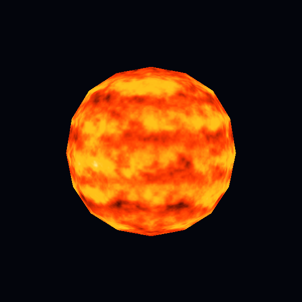
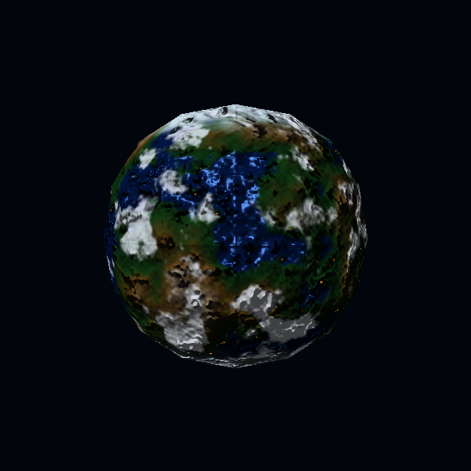
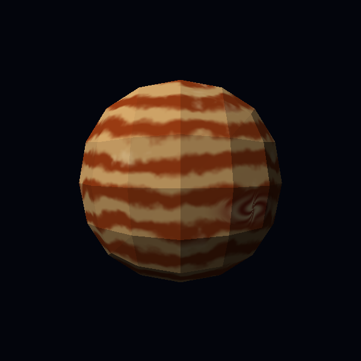
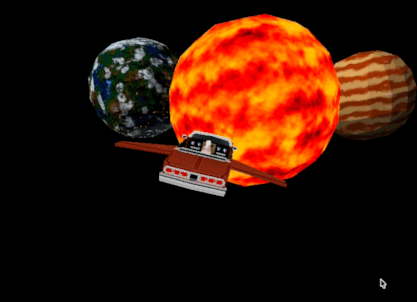

# CC2018 — Laboratorio 6: shaders procedurales en CPU

Sistema navegable con una estrella, un planeta rocoso y un gigante gaseoso. Los tres cuerpos usan exclusivamente `assets/sphere.obj`. Sus materiales se calculan por fragmento en CPU, sin texturas de superficie ni shaders de GPU.

## Ejecución

```bash
cargo run --release
```

Controles:

- `W` / `S`: bajar / elevar el morro.
- `A` / `D`: girar a izquierda / derecha.
- `Q` / `E`: alabeo.
- `Espacio`: acelerar.
- `Shift izquierdo`: frenar.
- Clic derecho + ratón: orbitar la cámara.
- Rueda: zoom.

Para regenerar capturas sin abrir la ventana:

```bash
cargo run --release -- --capturas
```

## Capturas

| Estrella | Planeta rocoso | Gigante gaseoso |
| --- | --- | --- |
|  |  |  |

## Demostración animada

Coloca el GIF de demostración en `assets/demo.gif` para mostrarlo en este espacio:



## Cobertura de la rúbrica

| Requisito o efecto | Implementación |
| --- | --- |
| Estrella procedural | FBM animado en dos escalas, filamentos y rampa térmica rojo–naranja–amarillo–blanco. |
| Regiones rocosas | Océano, vegetación, desierto/montaña y casquetes polares proceden de campos de ruido distintos. |
| Bandas atmosféricas | Latitud, ondas y turbulencia producen bandas crema, ámbar y pálidas. |
| Material animado | El plasma, las nubes y las bandas cambian con `time`; no dependen de rotar la geometría. |
| Día y noche | Luces urbanas ámbar aparecen sólo cuando el producto normal–luz está del lado nocturno. |
| Respuestas a la luz | El océano tiene brillo especular Blinn–Phong; continentes y hielo conservan respuesta difusa/mate. |
| Nubes procedurales | Una máscara FBM con cobertura configurable se desplaza independientemente sobre la misma esfera. |
| Tormenta localizada | El vórtice transforma las coordenadas antes de evaluar las bandas y añade una espiral interna. |
| Bump mapping | Derivadas finitas del campo de altura perturban la normal por fragmento, sin mover vértices. |
| Parallax | La posición de muestreo se desplaza sobre el plano tangente según altura y vector hacia la cámara. |
| Sombras de nubes | La misma máscara de nubes se remuestrea desplazada en dirección contraria a la luz. |

## Parámetros principales

Todos son constantes al inicio de los archivos indicados y se pueden ajustar sin cambiar el rasterizador.

### Planeta rocoso — `src/celestial_shaders/rocky.rs`

| Parámetro | Valor | Función |
| --- | ---: | --- |
| `CLOUD_COVERAGE` | `0.56` | Umbral de cobertura; subirlo reduce las nubes. |
| `CLOUD_SPEED` | `0.035` | Velocidad de desplazamiento independiente. |
| `BUMP_STRENGTH` | `0.34` | Intensidad de la perturbación de normales. |
| `PARALLAX_DEPTH` | `0.075` | Magnitud del desplazamiento dependiente de vista. |
| `CLOUD_SHADOW_OFFSET` | `0.085` | Separación aparente entre nube y sombra. |
| Exponente especular | `52` | Concentración del reflejo oceánico. |

La altura combina continentes FBM al 72 % y montaña al 28 %. La normal usa muestras tangente/bitangente separadas por `0.018`. Las ciudades combinan ruido de frecuencia 38 con una máscara costera y la máscara nocturna.

### Estrella — `src/celestial_shaders/star.rs`

- FBM principal: frecuencia `3.4`, 4 octavas.
- Granulación: frecuencia `14`, 3 octavas.
- Flujo: `(0.08, -0.035, 0.05) * time`.
- Los umbrales de la rampa térmica controlan manchas, plasma naranja, amarillo y zonas blancas.

### Gigante gaseoso — `src/celestial_shaders/gas_giant.rs`

- Turbulencia: frecuencia `4.5`, 4 octavas.
- Bandas: frecuencia latitudinal `25` y ondulación longitudinal `5`.
- Centro del vórtice: vector normalizado `(0.58, -0.18, -0.78)`.
- Radio de influencia: transición entre `0.10` y `0.46`.
- Giro máximo del dominio: aproximadamente `2.4` radianes.

## Arquitectura y comprobación

`src/celestial_shaders/` contiene los materiales; `src/shaders.rs` los ejecuta por fragmento; `src/triangle.rs` interpola posición local, posición mundial y normal; `src/capture.rs` renderiza las capturas con exactamente la misma ruta de CPU que la aplicación.

```bash
cargo fmt --check
cargo test
```

Las pruebas verifican la carga de la esfera proporcionada y límites/animación de los campos procedurales.
